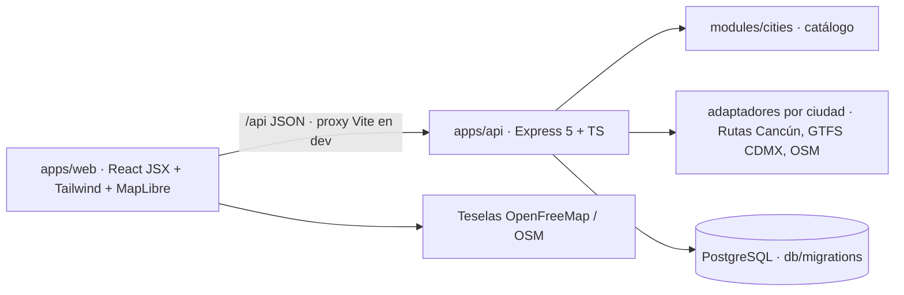

# Arquitectura

- **Monorepo npm workspaces** (`apps/web`, `apps/api`); `db/` y `docs/` son carpetas, no paquetes ([ADR-0001](../adr/0001-monorepo.md)).
- **Web:** `app/` compone; `features/<dominio>/` con `index.js` público; `shared/` genérico. Flujo componente → hook → `*.api.js` → `shared/lib/http.js`.
- **API:** `createApp()` en `app.ts` (testeable sin puerto) y `server.ts` solo escucha. `modules/<dominio>/routes.ts` valida con zod y lanza `AppError`; adaptadores de fuente en archivos aparte, funciones simples.
- **Multicidad:** la config de cada ciudad (`catalog.ts`) dice qué módulos tiene; el adaptador se elige por `cityId` con un objeto literal. Añadir ciudad = una entrada en el catálogo + sus adaptadores.
- **Datos:** PostgreSQL solo para lo que se escribe (incidencias, eventos curados). Snapshots estáticos versionados para datos abiertos (POI, zonas) mientras no haya que consultarlos espacialmente. PostGIS solo con caso real.
- **Motor de decisiones:** reglas deterministas en función pura con tests; cada salida explica por qué, fuente, fecha y confianza. LLM solo después (P2).
- **Seguridad:** CORS limitado a `WEB_ORIGIN`, JSON ≤ 200 kB, SQL parametrizado, sin secretos en `VITE_*`, errores sin trazas al cliente.
