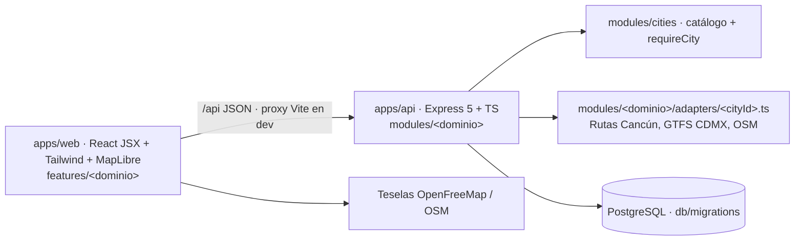

# Arquitectura

Monolito modular + feature-first + adaptadores por ciudad. Decisión, alternativas y cómo cambiarla: [ADR-0003](../adr/0003-monolito-modular-features-adaptadores.md).



## Estructura de carpetas

Lo marcado *(KH-0xx)* lo crea esa tarjeta; no se crean carpetas vacías por adelantado.

```text
apps/
├─ web/src/
│  ├─ main.jsx                    entrypoint
│  ├─ index.css                   tokens Tailwind (@theme)
│  ├─ app/                        composición, sin lógica de negocio
│  │  ├─ App.jsx                  cabecera + estados + pantalla
│  │  ├─ layout/                  AppHeader, BottomNav, SettingsSheet
│  │  ├─ navigation/              pestañas y ruta en la URL (?tab=)
│  │  └─ screens/                 una pantalla por pestaña (ver docs/03-design/screens.md)
│  ├─ features/<dominio>/         todo lo de un dominio junto
│  │  ├─ index.js                 API pública (lo único importable desde fuera)
│  │  ├─ <dominio>.api.js         llamadas HTTP vía shared/lib/http.js
│  │  ├─ use<Algo>.js             hook: { status, data, error, reload } con useResource
│  │  ├─ <Componente>.jsx         solo muestra
│  │  └─ <dominio>.js (+ .test.js) lógica pura si la hay
│  │  · cities/  map/  transit/ (KH-006)  discovery/ (KH-005)  events/ (KH-014)
│  │  · reports/ (KH-012)  budget/ (KH-010)  decisions/ (KH-013)
│  └─ shared/                     genérico; nunca importa features/ ni app/
│     ├─ i18n/                    idiomas: locales/{es,en}.json + useI18n().t() (ver docs/03-design/i18n.md)
│     ├─ lib/http.js              único cliente HTTP
│     ├─ hooks/useResource.js     patrón de carga común
│     └─ components/              LoadingState, ErrorState, DataStatusBadge
└─ api/src/
   ├─ server.ts                   solo escucha
   ├─ app.ts                      monta un router por módulo (1 línea cada uno)
   ├─ modules/<dominio>/
   │  ├─ index.ts                 API pública del módulo
   │  ├─ routes.ts                HTTP + validación zod
   │  ├─ <dominio>.ts             lógica (funciones puras cuando se pueda)
   │  ├─ adapters/<cityId>.ts     una fuente externa → tipo del contrato
   │  └─ <dominio>.test.ts
   │  · cities/  transit/ (KH-003)  discovery/ (KH-004)  events/ (KH-014)
   │  · reports/ (KH-011)  decisions/ (KH-013)
   └─ shared/                     errors, env, db, migrate, city-adapters
db/migrations/                    SQL versionado, nunca editar uno aplicado
docs/                             ver INDEX.md
```

## Reglas
- **Idiomas:** ningún texto fijo; todo en `shared/i18n/locales/<idioma>.json` con `t()` ([ADR-0004](../adr/0004-idiomas-json.md)).
- **Web:** `app/` compone; `features/<dominio>/` con `index.js` público; `shared/` genérico. Flujo componente → hook (`useResource`) → `*.api.js` → `shared/lib/http.js`.
- **API:** `createApp()` en `app.ts` (testeable sin puerto) y `server.ts` solo escucha. `routes.ts` valida con zod y lanza `AppError`. Un módulo importa otro solo por su `index.ts`.
- **Multicidad:** `catalog.ts` dice qué capas tiene cada ciudad; `pickAdapter()` elige la fuente por `cityId` de un objeto literal. Ciudad sin adaptador → `404 MODULE_UNAVAILABLE`.
- **Datos:** PostgreSQL solo para lo que se escribe (incidencias, eventos curados). Snapshots versionados para datos abiertos (POI, zonas) mientras no haya consultas espaciales. PostGIS solo con caso real.
- **Motor de decisiones:** reglas deterministas en función pura con tests; cada salida explica por qué, fuente, fecha y confianza. LLM solo después (P2).
- **Seguridad:** CORS limitado a `WEB_ORIGIN`, JSON ≤ 200 kB, SQL parametrizado, sin secretos en `VITE_*`, errores sin trazas al cliente.

## Recetas

### Añadir un módulo de API con datos por ciudad
1. Contrato primero en [`docs/04-api/contract.md`](../04-api/contract.md).
2. `modules/<dominio>/adapters/cancun.ts`: `export async function fetchX(): Promise<{ items, source }>` (normaliza la fuente).
3. `modules/<dominio>/routes.ts`:
   ```ts
   import { Router } from 'express';
   import { requireCity } from '../cities/index.js';
   import { pickAdapter, type CityAdapters } from '../../shared/city-adapters.js';
   import { fetchX as cancun } from './adapters/cancun.js';

   const adapters: CityAdapters<typeof cancun> = { cancun };
   export const xRouter = Router({ mergeParams: true });
   xRouter.get('/', async (req, res) => {
     const city = requireCity((req.params as { cityId: string }).cityId);
     res.json(await pickAdapter(adapters, city.id, 'X')());
   });
   ```
4. `modules/<dominio>/index.ts` exporta el router; en `app.ts`: `app.use('/api/cities/:cityId/<dominio>', xRouter);`.
5. Test con fixture recortado de la fuente real + test de fallo. Fila en `FILEMAP.md` y en el router de `README.md`.

### Añadir una feature web
`features/<dominio>/{<dominio>.api.js, use<Algo>.js, <Componente>.jsx, index.js}`. Sus textos van en una sección `<dominio>` de `es.json` y `en.json`. El hook es `useResource(fetchX, { cityId: city.id })`; la función de `*.api.js` va a nivel de módulo (estable). Se monta con una línea en la pantalla que la usa (`app/screens/*Screen.jsx`).

### Añadir una ciudad
Entrada en `apps/api/src/modules/cities/catalog.ts` (módulos en `PLANNED`/`UNAVAILABLE` hasta tener datos) + `adapters/<cityId>.ts` en cada módulo que la soporte. La web no cambia.
