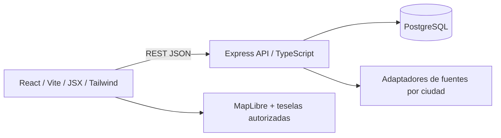

# Arquitectura mínima

- Monorepo npm workspaces: `apps/web`, `apps/api`, `db`, `docs`.
- Frontend `features` por dominio. Backend agrupa `modules` por dominio; evitar una segunda capa de abstracciones hasta requerirse.
- Los adaptadores normalizan `City`, `POI`, `TransitRoute`, `District`, `UrbanReport`, `Event`, `Expense`.
- El motor inicial de decisiones es determinista y explicable: filtros y puntuación simple por presupuesto, disponibilidad y incidencias. **No** introducir LLM hasta tener caso y evaluación.
- PostgreSQL para datos persistentes; no obligar DB para health/bootstrap inicial. No confiar en ids, gastos ni roles enviados sin validar.
- PostGIS solo si consultas espaciales reales lo justifican y el equipo puede instalarlo; inicialmente GeoJSON/coordinates con índices básicos.
- Observabilidad: errores claros, no rastrear localizaciones precisas innecesariamente; request IDs solo si útiles.
- Control de cambios: ADR cuando se cambia stack, entidades clave, integración de datos o contrato API.
