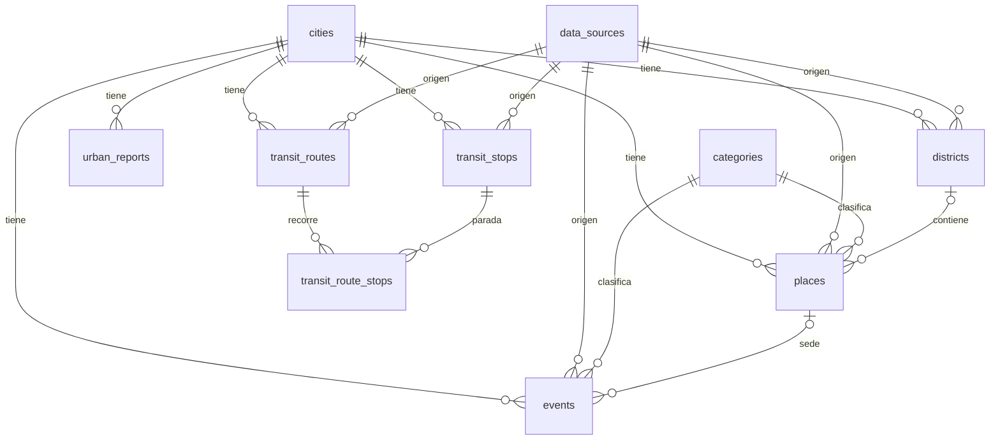

# Base de datos: arquitectura y diccionario

PostgreSQL 17 (16+ compatible). Esquema del MVP en `db/migrations/0001_init.sql` + `0002_mvp_schema.sql`; datos de catálogo y DEMO en `db/seeds/`. Decisión: [ADR-0006](../adr/0006-base-de-datos-mvp.md). Tareas pendientes: issues con la etiqueta `base-de-datos` en GitHub.

## Principios

1. **Procedencia en todo dato:** cada fila de contenido apunta a `data_sources` y lleva `data_status` (`REAL` / `DEMO` / `USER_REPORTED` / `UNVERIFIED`). La UI lo muestra siempre.
2. **Nada inventado como real:** lo simulado vive solo bajo la fuente `kindhop-demo` con `data_status = 'DEMO'`. Rutas de transporte: nunca se simulan.
3. **Sin PostGIS** (regla de AGENTS): puntos en `lat`/`lon` con índice `(city_id, lat, lon)` para filtrar por caja; polígonos y líneas en GeoJSON (`JSONB`) que la web pinta tal cual. Se reconsidera con >10 000 lugares o consultas de "cerca de".
4. **Textos de interfaz fuera de la BD:** las categorías se guardan por id; sus nombres están en `apps/web/src/shared/i18n/locales/*.json`. El contenido (títulos, nombres) va en español en su columna y las traducciones en `i18n JSONB` (`{"en": {"title": "…"}}`).
5. **Restricciones en la BD, no solo en la API:** estados con `CHECK`, dinero en `BIGINT` de centavos, tiempos en `TIMESTAMPTZ` (UTC), claves externas en todo. La API valida igualmente con zod.
6. **Importaciones idempotentes:** `UNIQUE (source_id, external_id)` en lo que viene de fuera, así reimportar = upsert.
7. **Privacidad:** sin cuentas, sin IP ni historial de ubicación guardados; coordenadas de incidencias redondeadas a 3 decimales (≈ 100 m) por la API. Presupuesto: sin tablas (local-first en el navegador).

## Diagrama



## Qué módulo usa cada tabla

| Tabla | Módulo API (`apps/api/src/modules/`) | Pantalla web | Tarjeta | Estado |
|---|---|---|---|---|
| `cities` | `cities` (API desde `catalog.ts`; tabla para FKs) | selector de ciudad | — | Catálogo estático = fuente de verdad; test `catalog.db.test.ts` vs tabla |
| `data_sources` | todos (procedencia en cada respuesta `source`) | etiquetas y créditos | — | Lista + seed |
| `categories` | `discovery`, `events` | categorías de Inicio y Explorar | KH-005 | Lista + seed |
| `places` | `discovery` | Explorar, Mapa, ficha de lugar | KH-004, KH-005, KH-007 | Lista + 10 DEMO |
| `events` | `events` | Inicio | KH-014 | Lista + 7 DEMO (la web aún usa su fixture) |
| `districts` | `discovery` | capa de zonas | KH-009 | Lista, sin datos (falta fuente con licencia) |
| `transit_routes`, `transit_stops`, `transit_route_stops` | `transit` | capa de transporte | KH-003, KH-006, KH-007 | Listas, sin datos (nunca DEMO) |
| `urban_reports` | `reports` | capa y formulario de incidencias | KH-011, KH-012 | Lista + 3 DEMO |
| *(presupuesto)* | — | Presupuesto | KH-010 | Sin tablas a propósito |

## Diccionario de datos

Convenciones: `PK` clave primaria · `FK` clave externa · `UQ` único · `ck` restricción `CHECK` · ✓ obligatorio.

### `cities` — ciudades piloto
| Columna | Tipo | ✓ | Descripción |
|---|---|---|---|
| `id` | TEXT PK | ✓ | `cancun`, `cdmx`. Mismo id que en la API y la URL (`?city=`) |
| `name` | TEXT | ✓ | Nombre visible |
| `country_code` | CHAR(2) | ✓ | ISO 3166-1 |
| `center_lat`, `center_lon` | DOUBLE | ✓ | Centro inicial del mapa |
| `timezone` | TEXT | ✓ | Zona IANA: las fechas de eventos se muestran en hora de la ciudad |
| `default_zoom` | REAL | ✓ | Zoom inicial del mapa |

### `data_sources` — procedencia
| Columna | Tipo | ✓ | Descripción |
|---|---|---|---|
| `id` | TEXT PK ck `^[a-z0-9-]{2,64}$` | ✓ | `kindhop-demo`, `osm`, `cdmx-gtfs`, `rutas-cancun-api`, `kindhop-comunidad` |
| `name` | TEXT | ✓ | Nombre de la fuente |
| `url` | TEXT | | Web de la fuente o de su licencia |
| `license` | TEXT | ✓ | Licencia (`ODbL 1.0`, `Por confirmar`…) |
| `attribution` | TEXT | | Texto de atribución que la UI muestra |
| `data_status` | TEXT ck | ✓ | Estado por defecto de sus datos |
| `retrieved_at` | TIMESTAMPTZ | | Última importación |
| `notes` | TEXT | | Límites, pendientes |

### `categories` — categorías de lugares y eventos
| Columna | Tipo | ✓ | Descripción |
|---|---|---|---|
| `id` | TEXT PK ck `^[a-z][a-z0-9_]{1,31}$` | ✓ | Igual que `apps/web/src/features/discovery/categories.js` |
| `applies_to` | TEXT[] ck ⊆ {place, event} | ✓ | A qué se aplica |
| `sort_order` | SMALLINT | ✓ | Orden en la UI |

### `places` — lugares de interés
| Columna | Tipo | ✓ | Descripción |
|---|---|---|---|
| `id` | BIGSERIAL PK | ✓ | |
| `city_id` | TEXT FK `cities` | ✓ | |
| `source_id` | TEXT FK `data_sources` | (✓ en código nuevo) | Procedencia |
| `external_id` | TEXT, UQ con `source_id` | | Id en la fuente (p. ej. `node/123` de OSM) para reimportar |
| `name` | TEXT | ✓ | Nombre en español |
| `category` | TEXT FK `categories` | ✓ | |
| `lat`, `lon` | DOUBLE ck rango | ✓ | WGS84 |
| `district_id` | BIGINT FK `districts` | | Zona a la que pertenece |
| `address` | TEXT | | |
| `is_free` | BOOLEAN | | `NULL` = no se sabe (el motor de decisiones no lo asume gratis) |
| `i18n` | JSONB | ✓ (`{}`) | Traducciones: `{"en": {"name": "…"}}` |
| `data_status` | TEXT ck | ✓ | |
| `retrieved_at` | TIMESTAMPTZ | | Fecha del dato en la fuente |
| `created_at` | TIMESTAMPTZ | ✓ | |
| `source_name`, `source_url`, `license` | TEXT | | **Legado de 0001**; usar `source_id` |

Índices: `(city_id, category)`, `(city_id, lat, lon)`.

### `events` — eventos
| Columna | Tipo | ✓ | Descripción |
|---|---|---|---|
| `id` | BIGSERIAL PK | ✓ | |
| `city_id` | TEXT FK `cities` | ✓ | |
| `source_id` | TEXT FK `data_sources` | | Procedencia |
| `external_id` | TEXT, UQ con `source_id` | | Id en la fuente |
| `title` | TEXT | ✓ | Título en español |
| `venue_name` | TEXT | | Lugar como texto (si no hay `place_id`) |
| `place_id` | BIGINT FK `places` (SET NULL) | | Sede enlazada |
| `category` | TEXT FK `categories` | | |
| `starts_at` | TIMESTAMPTZ | ✓ | UTC; la UI lo muestra en `cities.timezone` |
| `ends_at` | TIMESTAMPTZ ck > `starts_at` | | Un evento se lista mientras `ends_at` (o `starts_at`) sea futuro |
| `is_free` | BOOLEAN | | |
| `price_from_cents` | BIGINT ck ≥ 0 | | Precio desde, en centavos, solo si la fuente lo publica |
| `source_url` | TEXT | ck ✓ salvo `DEMO` | Enlace verificable al evento |
| `verified_at` | TIMESTAMPTZ | | Última verificación manual |
| `image_url` | TEXT | | Foto; si existe, ck exige autor, licencia y fuente |
| `image_author`, `image_license`, `image_license_url`, `image_source_url` | TEXT | ck | Crédito de la foto |
| `i18n` | JSONB | ✓ (`{}`) | `{"en": {"title", "venue", "imageAlt"}}` |
| `data_status` | TEXT ck REAL/DEMO/UNVERIFIED | ✓ | |
| `created_at` | TIMESTAMPTZ | ✓ | |

Índice: `(city_id, starts_at)`.

### `districts` — zonas
| Columna | Tipo | ✓ | Descripción |
|---|---|---|---|
| `id` | BIGSERIAL PK | ✓ | |
| `city_id` | TEXT FK | ✓ | |
| `source_id` | TEXT FK | ✓ | Solo fuentes con licencia verificada (KH-009) |
| `external_id` | TEXT, UQ con `source_id` | | |
| `name` | TEXT | ✓ | |
| `kind` | TEXT ck SUPERMANZANA/ALCALDIA/COLONIA/OTHER | ✓ | |
| `geometry` | JSONB ck Polygon/MultiPolygon | ✓ | GeoJSON simplificado (< 500 kB por ciudad) |
| `bbox` | DOUBLE[4] | | `[minLon, minLat, maxLon, maxLat]` para filtrar sin PostGIS |

### `transit_routes` — líneas de transporte
| Columna | Tipo | ✓ | Descripción |
|---|---|---|---|
| `id` | BIGSERIAL PK | ✓ | |
| `city_id` | TEXT FK | ✓ | |
| `source_id` | TEXT FK | ✓ | GTFS CDMX o caché de la API Rutas Cancún |
| `external_id` | TEXT, UQ con `source_id` | ✓ | `route_id` de la fuente |
| `name`, `short_name` | TEXT | ✓ / | |
| `mode` | TEXT ck bus/brt/metro/other | ✓ | |
| `color` | TEXT ck `#RRGGBB` | | |
| `geometry` | JSONB ck LineString/MultiLineString | ✓ | Trazo |
| `fare_cents` | BIGINT ck ≥ 0 | | Solo si la fuente publica la tarifa |

### `transit_stops` — paradas
| Columna | Tipo | ✓ | Descripción |
|---|---|---|---|
| `id` | BIGSERIAL PK | ✓ | |
| `city_id`, `source_id` | FK | ✓ | |
| `external_id` | TEXT, UQ con `source_id` | ✓ | `stop_id` de la fuente |
| `name` | TEXT | ✓ | |
| `lat`, `lon` | DOUBLE ck rango | ✓ | |

### `transit_route_stops` — orden de paradas por línea
| Columna | Tipo | ✓ | Descripción |
|---|---|---|---|
| `route_id` | BIGINT FK (CASCADE) | ✓ | PK con `sequence` |
| `stop_id` | BIGINT FK (CASCADE) | ✓ | |
| `sequence` | SMALLINT ck ≥ 0 | ✓ | Orden en el recorrido |

### `urban_reports` — incidencias comunitarias
| Columna | Tipo | ✓ | Descripción |
|---|---|---|---|
| `id` | BIGSERIAL PK | ✓ | |
| `city_id` | TEXT FK | ✓ | |
| `lat`, `lon` | DOUBLE ck rango | ✓ | Redondeadas a 3 decimales por la API |
| `kind` | TEXT ck FLOOD/PUDDLE | ✓ | |
| `description` | TEXT ck ≤ 500 | | |
| `status` | TEXT ck UNVERIFIED/CONFIRMED/RESOLVED/REJECTED | ✓ | Empieza en `UNVERIFIED` |
| `data_status` | TEXT ck DEMO/USER_REPORTED | ✓ | |
| `confirm_count` | INTEGER ck ≥ 0 | ✓ | Confirmaciones de otros usuarios |
| `moderated_at` | TIMESTAMPTZ | | Cuándo lo revisó un moderador |
| `moderation_note` | TEXT ck ≤ 280 | | |
| `created_at` | TIMESTAMPTZ | ✓ | |
| `expires_at` | TIMESTAMPTZ ck > `created_at` | ✓ | Caduca (p. ej. +6 h); la API solo lista los no caducados |

Índice: `(city_id, expires_at)`.

### Presupuesto (sin tablas)
Local-first en el navegador (`localStorage`), sin cuenta ni datos bancarios: ver [budget](../02-modules/budget.md). Si algún día se sincroniza (P2), harán falta cuentas y un ADR nuevo.

## Datos simulados (seeds)

| Archivo | Contenido | Se puede repetir |
|---|---|---|
| `db/seeds/0001_catalogo.sql` | 5 fuentes y 12 categorías | Sí (upsert) |
| `db/seeds/0002_demo.sql` | 10 lugares (coordenadas aproximadas), 7 eventos (4 Cancún con las fotos de la web, 3 CDMX), 3 incidencias | Sí: borra y regenera lo DEMO con fechas relativas a hoy |

Reglas: todo seed DEMO usa `source_id = 'kindhop-demo'` y `data_status = 'DEMO'`; nunca borra ni modifica datos `REAL`; nunca simula transporte.

## Cómo acceden los módulos

- Un archivo `<dominio>.db.ts` por módulo con funciones que reciben parámetros y devuelven el tipo del contrato, usando `query()` / `requireDatabase()` de `apps/api/src/shared/db.ts` y **SQL parametrizado** (`$1`). Sin repositorios genéricos ni ORM.
- La API arranca sin `DATABASE_URL`: `requireDatabase()` lanza **503 `MODULE_UNAVAILABLE`**; los módulos pueden usar catálogo estático u otro respaldo cuando aplique.
- PostgreSQL gestionado: suele hacer falta `DATABASE_SSL=true` (y a veces `DATABASE_SSL_REJECT_UNAUTHORIZED=false`) además de `DATABASE_URL` en secretos del proveedor.
- `GET /health` expone `{ database: { configured, connected } }` sin tumbar la API si la BD no responde.
- Mapeo snake_case (BD) → camelCase (contrato) dentro del `.db.ts`.

## Tareas pendientes (issues `base-de-datos`)

| Issue | Tarjeta | Qué |
|---|---|---|
| [#2](https://github.com/MoggerSir/KindHop/issues/2) | KH-014 | Servir eventos desde la BD (la web deja su fixture) |
| [#3](https://github.com/MoggerSir/KindHop/issues/3) | KH-004 | Importar lugares reales de OSM a `places` |
| [#4](https://github.com/MoggerSir/KindHop/issues/4) | KH-011 | API de incidencias sobre `urban_reports` |
| [#5](https://github.com/MoggerSir/KindHop/issues/5) | KH-007 | Línea de transporte de CDMX (GTFS) a `transit_*` — bloqueada por licencia |
| [#6](https://github.com/MoggerSir/KindHop/issues/6) | KH-003 | Transporte de Cancún: en vivo o snapshot — bloqueada por KH-002 |
| [#7](https://github.com/MoggerSir/KindHop/issues/7) | KH-009 | Zonas con licencia a `districts` — bloqueada por fuente |
| [#8](https://github.com/MoggerSir/KindHop/issues/8) | — | Ciudades: una sola fuente de verdad |
| [#9](https://github.com/MoggerSir/KindHop/issues/9) | — | Migración 0003: `source_id` obligatorio, retirar legado |
| [#10](https://github.com/MoggerSir/KindHop/issues/10) | KH-016 | Base de datos de la demo desplegada |
| [#11](https://github.com/MoggerSir/KindHop/issues/11) | KH-013 | Consultas del motor de decisiones |

## Comandos

```bash
docker compose up -d db                       # PostgreSQL local (o el tuyo)
cp apps/api/.env.example apps/api/.env        # descomentar DATABASE_URL
npm run db:migrate                            # aplica migraciones pendientes (idempotente)
npm run db:seed                               # catálogo + datos DEMO (repetible)
DATABASE_URL=… npm test -w @kindhop/api       # incluye los tests del esquema
```

La CI aplica migraciones y seeds dos veces y corre los tests del esquema contra PostgreSQL 17.
